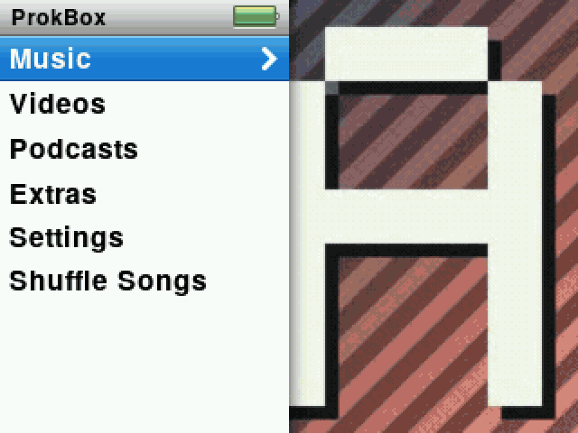
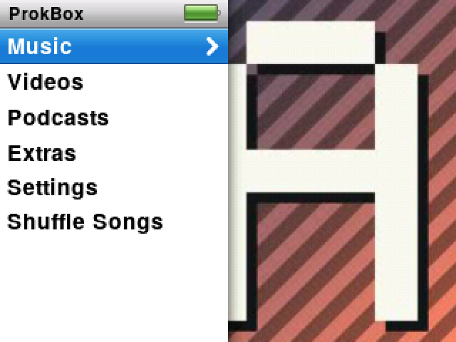
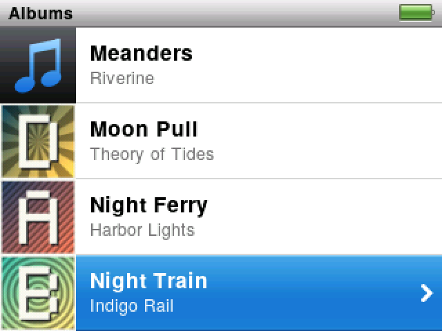
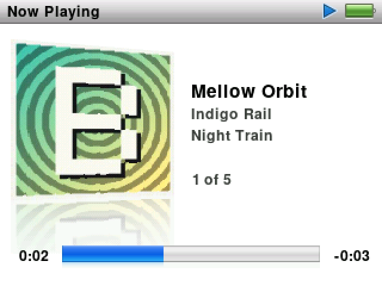
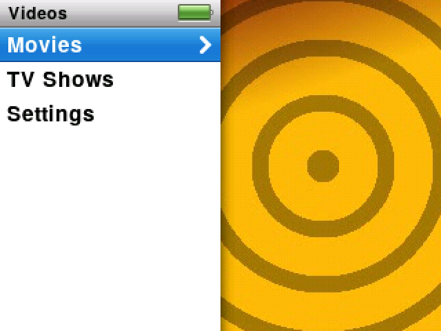
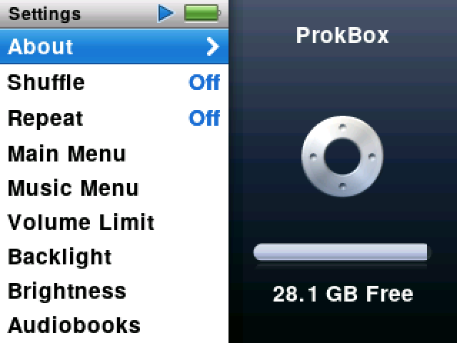
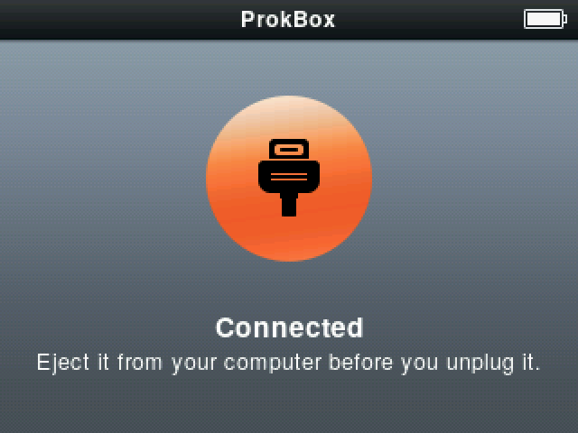

# ProkBox5g

**ProkBox5g: a device-tuned fork of Rockbox for the iPod Video (5G/5.5G).**

ProkBox5g is free, open-source firmware for the iPod Video, 5th generation and 5.5. It gives the player menus, a Now Playing screen and settings designed to feel like the iPod classic's final software (2.0.5), and keeps what [Rockbox](https://www.rockbox.org), the firmware it is built on, does well: almost every music format, and audiobooks with chapters, a saved place in every book and a choice of speed. You copy music on and off over USB, with no sync app. Apple's own software stays on the player, so you can always go back.

**Current release: ProkBox5g 0.8.3, a pre-release, published 14 November 2026.** It is in daily use on one modded player. Only one kind of player (flash, 64 MB, 3,000 mAh battery, USB-C) has been tested on real hardware so far, so back up your music before you install.

> ProkBox5g is not Apple software. It is an independent, community-driven fork of Rockbox, and Apple Inc. has not made, approved, endorsed or supported it in any way. It contains no Apple software. iPod is a trademark of Apple Inc.

## Contents

- [Features at a glance](#features-at-a-glance)
- [Screenshots](#screenshots)
- [Download and install](#download-and-install)
- [What's coming](#whats-coming)
- [Documentation](#documentation)
- [Reporting problems and contact](#reporting-problems-and-contact)
- [Building from source](#building-from-source)
- [How it is made](#how-it-is-made)
- [Credits](#credits)
- [Licence](#licence)
- [Not affiliated with Apple](#not-affiliated-with-apple)

## Features at a glance

What ProkBox5g does today. The [Features](https://prokbox.github.io/prokbox5g/features/) page compares it, row by row, with the player's original software (1.3) and with Rockbox 4.0, and marks what is still planned.

- **Drag and drop.** Copy music onto the player over USB, and copy it back off again, with no sync app. Music a computer sync already put on the player plays too, with its covers; ProkBox5g only reads it and never changes it.
- **Almost every format.** MP3, AAC, Apple Lossless (ALAC), WAV and AIFF; FLAC, Ogg Vorbis and Opus; WMA, Monkey's Audio, WavPack, Musepack and many less common formats; music from game consoles and trackers. No gap between tracks of a continuous album, for most formats.
- **Audiobooks.** An Audiobooks menu, chapters in .m4b and MP3 books, a saved place in every book, and Slower, Normal or Faster playback at the same pitch. Podcasts have their own menu too.
- **Browsing and playlists.** Artists, albums, genres, composers and Search; an On-The-Go playlist made on the player; .m3u playlist files from a Playlists folder.
- **Sound.** 22 equaliser presets, Sound Check (using ReplayGain tags in your files) and a volume limit with an optional code.
- **Album art** on Now Playing, from the picture inside the file, a picture file in the same folder, or covers already on the player.
- **Video.** H.264 video at 320 × 240, once converted with the free converter that comes with ProkBox5g.
- **Extras.** Clocks, alarms, a stopwatch, screen lock, notes, contacts and calendars.
- **A short settings list,** like the original, in place of Rockbox's hundreds of options.
- **Safe to try.** Apple's software stays on the player: slide Hold on and restart, or hold Menu as it starts.

Not there yet, among others: MP3 and AAC music is still sent to the audio chip at 16-bit and 48 kHz at most (24-bit FLAC, WAV and AIFF now play at full depth), menus are in English only, and Japanese, Chinese and Korean characters in song names show as blanks. The [0.8.3 release notes](https://prokbox.github.io/prokbox5g/releases/0.8.3/) list the known issues, and [What's coming](#whats-coming) says when each is planned.

## Screenshots

<p align="center">
  
</p>

<table>
  <tr>
    <td align="center"><br><sub>Main menu, with your album art drifting beside it</sub></td>
    <td align="center"><br><sub>Albums, each with its cover</sub></td>
    <td align="center"><br><sub>Now Playing</sub></td>
  </tr>
  <tr>
    <td align="center"><br><sub>Videos, with posters from your films</sub></td>
    <td align="center"><br><sub>Settings, showing how much room is left</sub></td>
    <td align="center"><br><sub>Plugged in: copy music across, no sync app needed</sub></td>
  </tr>
</table>

Every screen here is the simulator running a made-up test library: the artists, albums and cover patterns are generated by our test scripts, never taken from anyone's music. `scripts/docs_shots.sh` makes these images and the user guide's screenshots from named simulator scripts (listed in `tests/ui/docs/images.tsv`).

## Download and install

Download from the [Releases page on GitHub](https://github.com/prokbox/prokbox5g/releases). From 0.8.3 there is **one zip for every iPod Video**, whichever battery, storage and memory it has:

```
ProkBox5g-0.8.3.zip
```

The player finds out by itself whether it has a hard drive or flash and 32 or 64 MB of memory, and the first start asks which battery is fitted (stock, 2,000 mAh or 3,000 mAh). The dock connector works on every player.

Only **flash, 64 MB, 3,000 mAh and USB-C** has been tested on a real player. Hard-drive players, 32 MB players, the original batteries and accessories on the dock connector should work but are untested; reports from testers are very welcome.

Each release also carries the install tool, `ipodpatcher`, ready to run on macOS, Windows and Linux; a `SHA256SUMS` file to check the downloads; the user guide as a PDF; and the complete source code for that release.

[Getting started](https://prokbox.github.io/prokbox5g/guide/getting-started/) walks through choosing the right zip, checking it, installing and the first start. Installing is a one-time step of about 20 minutes; after that, an update is a matter of copying files. [Going back to Apple's firmware](https://prokbox.github.io/prokbox5g/guide/going-back/) explains every way back, from a single restart to a full restore.

## What's coming

ProkBox5g is in its 0.8 pre-releases. The 0.9 releases add features theme by theme, and 1.0 brings our own start-up software, Disk Mode, recovery and an installer, so you can fully replace the original software if you want to. The next release, 0.9.0, is about sound and languages: better audio, menus in more languages and better song details.

- [What's coming](https://prokbox.github.io/prokbox5g/roadmap/): the release plan, release by release, with the state of every item. It is a plan, not a promise.
- [Changelog](https://prokbox.github.io/prokbox5g/changelog/): everything that has changed, release by release.
- [Release notes](https://prokbox.github.io/prokbox5g/releases/): what is new, what is fixed and the known issues for each release.
- [Features](https://prokbox.github.io/prokbox5g/features/): where ProkBox5g stands against the original software and Rockbox, with planned items linked to the release plan.

## Documentation

Everything is on the [ProkBox5g site](https://prokbox.github.io/prokbox5g/); a version picker on every page shows the docs for earlier releases.

- [User Guide](https://prokbox.github.io/prokbox5g/guide/): [Getting started](https://prokbox.github.io/prokbox5g/guide/getting-started/), [Music](https://prokbox.github.io/prokbox5g/guide/music/), [Audiobooks](https://prokbox.github.io/prokbox5g/guide/audiobooks/), [Video](https://prokbox.github.io/prokbox5g/guide/video/), [Making videos that play well](https://prokbox.github.io/prokbox5g/guide/video-converter/), [USB and syncing](https://prokbox.github.io/prokbox5g/guide/usb-and-syncing/), [Settings](https://prokbox.github.io/prokbox5g/guide/settings/), [Troubleshooting](https://prokbox.github.io/prokbox5g/guide/troubleshooting/) and [Going back to Apple's firmware](https://prokbox.github.io/prokbox5g/guide/going-back/).
- [Developers](https://prokbox.github.io/prokbox5g/developers/): *The ProkBox Reference*, for building, testing and changing the firmware, and for how the player's hardware works. Its sources are in [`docs/manual/`](docs/manual/_index.md).
- In this repository: the hardware references for the main processor ([`docs/pp5022-reference/`](docs/pp5022-reference/index.md)) and the video processor ([`docs/bcm2722-reference/`](docs/bcm2722-reference/index.md)), still being written.

## Reporting problems and contact

- **Bugs:** open an issue on [GitHub Issues](https://github.com/prokbox/prokbox5g/issues/new/choose); the form asks for what we need. On the player, Settings › About › Save Diagnostics writes a report file you can attach; [Troubleshooting](https://prokbox.github.io/prokbox5g/guide/troubleshooting/) shows how.
- **Testing a variant nobody has tried yet:** the tester report form on the same page is the place for it.
- **Questions and ideas:** [Discussions](https://github.com/prokbox/prokbox5g/discussions).
- **Everything else,** including trademark or takedown requests: **prokbox.project@gmail.com**. We answer complaints within a few days.

## Building from source

You need GCC 16 as an ARM cross-compiler (`arm-none-eabi-gcc`) and a native compiler for the simulator. [FW-3](https://prokbox.github.io/prokbox5g/developers/fw/03-toolchain/) sets up either on macOS with Homebrew or on Linux with the project's Nix environment (`flake.nix`). Every build lives in its own directory under `build/`:

```sh
# the simulator, with the ProkBox5g interface
mkdir -p build/sim && cd build/sim
../../tools/configure --target=22 --type=s --ipodui </dev/null && make -j8

# the firmware for the player
mkdir -p build/fw && cd build/fw
../../tools/configure --target=22 --type=n --ipodui --compiler-prefix=arm-none-eabi- </dev/null
make -j8 && make zip
```

The release zips themselves come from `scripts/release_build.sh`, the same script the release workflow runs. [FW-4](https://prokbox.github.io/prokbox5g/developers/fw/04-building/) covers every build, [FW-18](https://prokbox.github.io/prokbox5g/developers/fw/18-testing/) the tests, and [FW-20](https://prokbox.github.io/prokbox5g/developers/fw/20-contributing/) how to send a change. Rockbox's own build notes are in [`docs/README`](docs/README).

## How it is made

ProkBox5g is developed with the help of AI coding assistants. A person directs the work, reviews and tests it, and decides what ships; the assistants write much of the code and documentation under that direction. Every change goes through the same build, test and review gates, whoever wrote it.

## Credits

The full list is in [`CREDITS`](CREDITS).

- **ProkBox** is by prokopto-dev, released under the **GNU General Public License v2 or later** ([`docs/COPYING`](docs/COPYING)). Every file the project adds carries the ProkBox header ([`docs/templates/prokbox-header.txt`](docs/templates/prokbox-header.txt)).
- **Rockbox:** this firmware is a fork of Rockbox (<https://www.rockbox.org>, <https://github.com/Rockbox/rockbox>), the work of many contributors over two decades, also GPL v2 or later. Files taken from upstream keep their original headers and credits. This repository keeps Rockbox's own history up to the upstream commit we forked from; on top of it sit one commit that removes the upstream code this build never compiles, then one import commit per ProkBox5g release and later development.
- **ipodpatcher** (the install tool attached to releases): Dave Chapman and Rockbox contributors (<https://www.rockbox.org>), GPL v2 or later, built unmodified from [`utils/ipodpatcher`](utils/ipodpatcher) in the matching source download.
- **Fonts:** TeX Gyre Heros (GUST Font License), shipped as "ShellSans", with ten glyphs from DejaVu Sans (Bitstream Vera Fonts licence; DejaVu changes public domain). Licence texts are in [`apps/ipodui/fonts/`](apps/ipodui/fonts).
- **Codec and support libraries** (under `lib/`) keep their own licences and notices.
- **Artwork:** all glyphs, gradients and images are original to this project.
- **Test footage:** the video clips used by the developer device test are not in this repository or in any release. `bcmfw/video/mkclip-real.sh` (a 13-second excerpt) and `bcmfw/video/mkclip-conv.sh` (a 40-second excerpt) make them from the *Sintel* trailer, (c) Blender Foundation | durian.blender.org, licensed under [CC BY 3.0](https://creativecommons.org/licenses/by/3.0/); the clips they make keep that credit.

## Licence

- **Code:** GNU General Public License, version 2 or (at your option) any later version ([`docs/COPYING`](docs/COPYING)). Rockbox's own files keep their original copyright headers; files we changed are listed, with what changed, in [`docs/changes-from-rockbox.md`](docs/changes-from-rockbox.md), and each also carries a "Modified for ProkBox5g" line in its header.
- **Third-party code and fonts:** their own licences, kept in [`docs/LICENSES`](docs/LICENSES), under `lib/` and in [`apps/ipodui/fonts/`](apps/ipodui/fonts).
- **Docs and site prose:** CC BY-SA 4.0.
- Every release ships its complete corresponding source next to the binaries. How each obligation is met is recorded in [`docs/legal.md`](docs/legal.md).

## Not affiliated with Apple

ProkBox5g is not Apple software and not an Apple product. It is free, open-source, community-driven firmware: a fork of Rockbox, tuned for the iPod Video (5th generation and 5.5). Apple Inc. did not make it, has not approved or endorsed it, does not support it, and has no connection with this project. If something goes wrong with ProkBox5g, ask the ProkBox community, not Apple. iPod, iPod classic, iTunes, Click Wheel, Cover Flow and Apple are trademarks of Apple Inc., registered in the U.S. and other countries. We use those names only to say which hardware ProkBox5g runs on. ProkBox5g contains no Apple software, fonts, logos or artwork.

Reference material used during development stays private and is never committed.
