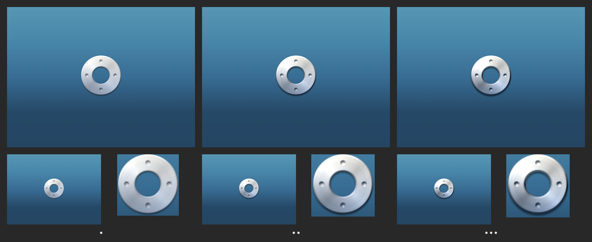
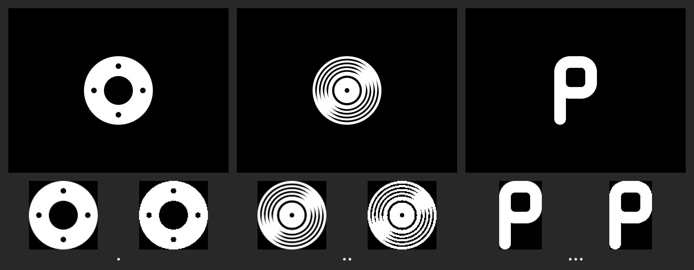

> **Decision (owner, 2026-10-07): variant 1, "wheel"**, rendered **3-D in spun metal on a blue-grey gradient** to match the real 7G boot screen (section "wheel3d" below, which supersedes the flat-white plan further down). **Strength: MEDIUM** (owner, 2026-10-07; `wheel3d-medium-*`). The other flat variants are kept for the record only.

# Boot glyph (POL-1)

## wheel3d: the chosen glyph in metal, on the 7G gradient (2026-10-07)

The owner's photo of their own 7G booting (kept local, gitignored, never
committed) showed that the stock boot screen is **not white on black**. The
background is a **blue-grey vertical gradient**, and the logo is **silvery
and shaded**: lighter at the top, cooler blue-grey lower down. The owner
confirmed both in person. On top of that, the owner asked for the
late-2000s look ("a lot of gradient hues and metallic, 3D-looking
images"). So the wheel is now drawn as **spun metal**: a top-lit silver
gradient from warm white to cool blue-grey, a rounded bevel, a conic
spun-metal sheen with a faint concentric grain, an Aqua-style gloss cap,
dished-in dots, a cut-through centre with an inner shadow, and a soft drop
shadow. It comes in three strengths for the owner to pick from.

*`logo/wheel3d-contact.png`, left to right: **subtle**, **medium** and
**pronounced** (one, two or three dots underneath). Top row: the boot
screen drawn at 2x from the vectors. Bottom row: the 1x screen exactly as
the LCD shows it (RGB565, dithered), then the stored 1x block magnified 3x
with nearest-neighbour scaling.*

### Measurements from the photo

The photo is 592 × 444. The screen's top edge is cut off.

| What | Photo px | Device px | How |
|---|---|---|---|
| Lit screen area, left/right | x = 92 / ≈ 437 (the black glass border is 83–91 and 437–446) | 0 / 319 | luminance edge on rows 0–165; width 341–354 per row, no clear keystone |
| Scale | **≈ 1.08 photo px per device px** | | 346 / 320. The owner's 85–448 includes the black border, which gives 1.13. |
| Lit area, bottom | y ≈ 234 | 239 | |
| Lit area, top | ≈ −25 (off the photo) | 0 | from the scale |
| Stock logo bounding box | x 230–299, y 63–139 (threshold at half-maximum) | **≈ 65 wide × 71 tall** | |
| Stock logo centre | x 264.5 (screen centre 264) | **x ≈ 160** (centred), **y ≈ 117** | top ≈ 82, bottom ≈ 152 |

**Chosen:** a ring of **68 px** diameter (between the stock logo's width
and height, since ours is round), centred on **(160, 117)**: rows 83–150,
columns 126–193. That is 3 px above the screen centre, which is the
"a little above centre" the owner saw. It is one constant each in the
generator (`W3D_PX`, `W3D_CX`/`W3D_CY`).

### The background gradient

The centre columns were sampled (photo x ≈ 215 and 320, either side of the
logo), every 30 photo rows, and corrected as follows:
- **Vignetting / viewing angle.** At the top of the photo the edges are
  about 22 % darker than the centre. At the bottom they are not. That is a
  lens or viewing-angle effect, not a horizontal gradient, so the centre
  columns are used and the gradient is purely vertical.
- **White balance.** The white bezel and click wheel read (191, 217, 229),
  so the camera ran cool. Correction: R × 1.1, B × 0.95.
- **Saturation.** Phone cameras boost saturation, and the owner describes
  the screen as blue-*grey*, so colours are desaturated 20 % toward their
  luminance.
- **The bottom 5 photo rows** brighten slightly (G 70 → 75). That is glare
  from the bezel and is ignored: the gradient flattens out instead.
- **Blur** only matters at the logo's edges; the background is smooth.

The measured profile is gentle at the top, steepest through the middle and
flat in the bottom quarter. That gives five stops, linear in between:

| Row | RGB (8-bit) | RGB565 (undithered) |
|---|---|---|
| 0 | (87, 150, 180) | 0x5cb6 |
| 60 | (72, 134, 168) | 0x4c34 |
| 120 | (57, 109, 147) | 0x3b72 |
| 180 | (38, 72, 103) | 0x2a4d |
| 239 | (38, 70, 98) | 0x2a2c |

Over 240 rows that is only about 7 red, 7 blue and 21 green RGB565 steps,
which would band visibly. The screen therefore uses a **2 × 2 ordered
dither** anchored to screen coordinates, so each row is two colours
alternating (one for even x, one for odd x). The absolute brightness is
whatever the camera exposed; whether it matches the panel's
backlight-on look can only be judged on the device.

### Shading (all procedural, `art/boot/bootlogo.py --3d`)

- **Metal base:** a vertical gradient over the ring, warm white
  (250, 247, 238) → silver (204, 210, 219) → cool blue-grey
  (122, 140, 166). This is the faint warm-to-cool shift.
- **Bevel:** a rounded profile over the outer and inner edges (1.5–2.1 px
  wide), with normals from the ring's signed distance field. One light
  from the top, slightly left: the outer-top rim and the lip at the
  centre's lower edge catch the light and a Blinn specular highlight; the
  outer bottom and the centre's upper inner edge fall into shade.
  Down-facing bevel picks up the blue of the background.
- **Spun metal:** a conic sheen (bright lobes upper-left and lower-right,
  dark lobes at the other diagonals) plus a faint concentric grain, so the
  ring reads as turned aluminium. It is a wheel, after all.
- **Dots:** dished-in bowls, upper wall dark and lower wall lit, floor
  slightly occluded. Their radius is 4.5 design units (flat: 4.0), so they
  still read as dishes at 68 px.
- **Centre:** cut through to the gradient, with the inner edge darkened
  (occlusion) and a soft inner shadow cast by its top edge.
- **Gloss:** a soft elliptical cap over the upper half, Aqua-style.
- **Drop shadow:** soft, offset straight down.

| Strength | Bevel slope / width | Sheen | Gloss | Shadow (opacity / dy / blur) | Base contrast |
|---|---|---|---|---|---|
| subtle | 1.1 / 1.5 px | 0.12 | 0.07 | 0.30 / 1.0 / 1.4 px | 0.80 |
| medium | 1.5 / 1.8 px | 0.18 | 0.13 | 0.42 / 1.4 / 1.7 px | 1.00 |
| pronounced | 2.0 / 2.1 px | 0.26 | 0.22 | 0.55 / 1.8 / 2.0 px | 1.15 |

Even "subtle" keeps the bevel, specular rim, sheen and dished dots, so it
still reads as 3-D metal. It only has less gloss and contrast, as the
owner asked before ("a little less pronounced").

Nothing Apple: no fruit, leaf or bite. It is a turned metal ring with four
dishes and an open centre, and no Apple artwork or font was used. The
reference photo was only measured, never sampled into the art.

Files (in `logo/`): `wheel3d-<strength>-screen.png` (320 × 240, exactly
what the LCD shows), `wheel3d-<strength>-screen@2x.png` (re-rendered
from the vectors at 640 × 480, preview only), `wheel3d-<strength>-glyph.png`
(the stored block), and `wheel3d-contact.png`. The generator is stdlib
only. `--3d` takes about 17 s of CPU, `--flat` regenerates the old
variants unchanged.

### Format decision: pre-composited opaque RGB565 block + per-row gradient table

The background never changes, so the glyph, its anti-aliased edges and
its shadow are **composited onto the gradient at build time**. The result
is a plain opaque RGB565 rectangle: every pixel that differs from the
bare gradient, cropped. Drawing it needs no alpha blending at all.

| Option | Draw routine (already linked in both) | Bytes (subtle / medium / pronounced) | Notes |
|---|---|---|---|
| **A. Pre-composited RGB565 block** (chosen) | `lcd_bitmap_part()` (or a row `memcpy` into `FBADDR`) | **9,800** (70 × 70) / **10,224** (72 × 71) / **10,368** (72 × 72) | bit-exact; tied to this background, which is fixed |
| B. RGB565 + 4-bit alpha (`struct bitmap`, `alpha_offset`) | `lcd_bmp_part()` → `lcd_alpha_bitmap_part_mix` | 12,250 / 12,780 / 12,960 | works on any background, but only 16 alpha levels (the shadow bands) and costs ~25 % more; no `bmp2rb` path for it |
| C. 4-bit alpha mono (the flat plan) | `lcd_alpha_bitmap_part()` | 2,312 | one colour only: cannot shade. Rejected. |
| Full-screen RGB565 bitmap | `lcd_bitmap()` | 153,600 | does not fit the bootloader's IRAM. Rejected. |

**Background:** a table of **240 rows × 2 RGB565 colours (even x, odd
x) = 960 B**, filled per row with 160 32-bit stores into the framebuffer
(`FBADDR(0, y)`, ~20 instructions of code). Without dither it would be
480 B with `memset16` (already linked in the bootloader), but it would
band. `lcd_hline`/`lcd_fillrect` are *not* linked in the bootloader today
(+324 B if used), so writing the framebuffer directly is the cheapest
option.

**Totals:** about **11.2 KB** (medium: 10,224 + 960 + ~40 B code) of
IRAM-resident rodata in the bootloader, out of ~70 KB free. In the
firmware it is `INIT_ATTR` (freed after boot, **0 B resident**). Dropping
`rockboxlogo.320x98x16.bmp` from the shell build (62,720 B) makes the
binary a net **~51.5 KB smaller**. Draw time: 76,800 framebuffer stores
plus a 72 × 72 block copy, under 5 ms at 30 MHz, then one `lcd_update()`.

### Integration plan for the flat glyph (superseded by the wheel3d plan above)

1. **One generated data file for both stages.** The generator gains a
   `--c` output that writes `bootscreen_data.{c,h}`: `BOOTSCREEN_X/Y/W/H`,
   `const unsigned short bootscreen_bg[240][2]` and
   `const unsigned short bootscreen_block[H*W]`, in the chosen strength.
   **Commit the generated files**; the build must not depend on Python.
2. **One draw function for both stages**, e.g.
   `firmware/common/bootscreen.c: void bootscreen_draw(void)` (fill the
   rows from the table, copy the block, no `lcd_update`). It lives under
   `firmware/` so the bootloader and `apps/` both link the same object.
   Because both stages run the same code on the same data, the hand-off
   is **pixel-identical by construction**. The dither is anchored to
   screen x/y, so there is no phase drift.
3. **Config flag.** The bootloader is built without `--ipodui` today, so it
   needs its own flag: a `HAVE_IPOD_BOOTSCREEN` set by `configure`
   (`--ipodui`, honoured for `--type=b` too), documented in
   `docs/hardware.md` by its owner. `#ifdef` guards keep the stock build
   untouched.
4. **Bootloader** (`bootloader/ipod.c`, `firmware-platform`): replace
   `lcd_clear_display()` + the banner `printf`s with `bootscreen_draw();
   lcd_update();`. The `printf` lines become verbose-only, and errors still
   print (over the gradient, white text). Data in IRAM: ~11.2 KB.
5. **Firmware** (`apps/main.c` `show_logo_boot()`, `#ifdef HAVE_IPOD_UI`):
   `bootscreen_draw(); lcd_update();`, with **no** `lcd_clear_display()`
   before it and no version string. Data and code `INIT_ATTR`. Drop the
   upstream logo bitmap from the shell build.
6. **Golden:** propose a sim screenshot of `show_logo_boot()` for
   `scripts/golden_capture.sh`, compared byte for byte against
   `logo/wheel3d-<strength>-screen.png`.

Device-only checks: whether the firmware's `lcd_init()` blanks the panel
between the two stages (a flash); the gradient's brightness and hue on
the real panel next to a 7G; whether the 2 × 2 dither is invisible at the
panel's pitch; and time to first frame.

### Doubts about the photo

- The **vertical scale is assumed equal to the horizontal**. The top of
  the screen is cut off, so it can't be checked directly. The stock logo's
  bounding box reads 0.91 wide-to-tall, while the shape is usually about
  0.82. Either the camera foreshortened the photo vertically by ~10 % (then
  the logo is ~79 px tall and its centre ~104), or blur widened it.
  Position y = 117 ± 10 and size 65–79 px are the honest range. 68 px at
  117 sits inside it.
- **Absolute colour:** the white-balance and saturation corrections are
  judgement calls (the bezel may itself reflect blue screen light). The
  stops are one table in the generator and cheap to retune after a
  side-by-side look on the device.
- The photo is soft (hand-held, finger in frame), so edge positions are
  ±1–2 photo px (±1–2 device px).

## The original flat candidates (record)

Owner decision: the boot logo is **a minimal abstract/geometric glyph**,
original, centred like the stock boot screen. The 7G shows a white glyph
on black at power-on, so every candidate is flat white on a black field, no
gloss and no text. This page lists three candidates for the owner to choose
from (#16). Nothing is wired in yet.

*Contact sheet (`logo/contact.png`), left to right: variant 1, 2, 3 (one,
two or three dots underneath). Top row: the boot screen drawn at 2x from the
vectors. Bottom row: the 1x glyph as the LCD shows it, then the 1-bit
fallback, both magnified 2x with nearest-neighbour scaling so the pixels
show.*

## The variants

| # | Name | Idea | Glyph (1x) |
|---|---|---|---|
| 1 | **wheel** | A broad ring with four small holes at the compass points and an open centre: the click wheel with its four button marks, abstracted. The ring's inner/outer ratio (21/50) follows the real wheel's select button. | 100 × 100 |
| 2 | **groove** | A record seen face-on: a disc with four concentric grooves that taper and vanish along a diagonal sheen (up-right/down-left), a label edge and a spindle hole. Music, without being a note. | 100 × 100 |
| 3 | **pbox** | A soft geometric monogram for the working name ProkBox: a "P" whose bowl is a rounded box, the stem ending in a round foot. | 62 × 100 |

Rationale and checks:
- **Not anyone's mark.** No fruit, leaf or bite, no enclosing tile. The wheel
  avoids a bullseye (no centre disc), the groove avoids the generic CD icon
  (no rainbow sheen, the sheen is negative space), and the P has no
  enclosure (unlike the parking sign) and no script (unlike the well-known
  script-P marks).
- **Size.** The glyph is 100 px tall on the 320 × 240 screen, centred on
  (160, 120). That is our estimate of the stock logo's presence; it is one
  constant (`GLYPH_PX`) in the generator if the owner wants it smaller.
  There is no owner photo of the 7G boot screen yet (`INDEX.md` lists it as
  wanted), so the size is to be checked against one.
- **Pixel fidelity.** The screen PNGs are exactly what the LCD shows:
  coverage quantised to the 16 levels of Rockbox's 4-bit alpha format, grey
  levels rounded to RGB565.
- **1-bit fallback.** Wheel and pbox survive 1-bit well. Groove does not:
  its tapering grooves break into stair-steps, so if the bootloader had to
  be 1-bit, groove would need untapered grooves. With the 4-bit plan below
  no 1-bit copy is needed.

## Files

- Generator: `art/boot/bootlogo.py` (stdlib only; `python3
  art/boot/bootlogo.py [OUTDIR]`, default `out/logo/`, ~25 s). Shapes are
  unions and differences of circles and rounded rectangles in design units,
  rasterised with 6 × 6 supersampling.
- Per variant, in `out/logo/` and copied here under `logo/`:
  `<v>-screen.png` (320 × 240), `<v>-screen@2x.png` (640 × 480),
  `<v>-glyph.png` (cropped, 4-bit alpha as shown), `<v>-glyph-1bit.png`.

## What the bootloader and firmware draw today

| | Bootloader (`bootloader/ipod.c`) | Firmware splash (`apps/main.c` `show_logo_boot()`) |
|---|---|---|
| Draws | **no logo**: white-on-black `printf` text ("Rockbox boot loader", version, ATA, partition lines) | `bm_rockboxlogo`, **320 × 98 RGB565** (`apps/bitmaps/native/rockboxlogo.320x98x16.bmp`, `bmp2rb -f 4`), at y = 10, plus `"Ver. <rbversion>"` in SYSFIXED at the bottom |
| Bytes | 0 (the 320 × 98 logo is compiled but garbage-collected) | **62,720 B** of pixels (`.initdata` 0xf518 in `fw-ui/rockbox.map`): `INIT_ATTR`, loaded with the binary, overwritten after boot |
| Where it lives | the whole bootloader runs from **IRAM**: `.text` + `.data` in 128 KB (`boot.link`), minus an 8 KB stack; today 52,940 B, so ~70 KB free | `.init` section, reclaimed after boot: no resident RAM |

Both are visible Rockbox branding in the `HAVE_IPOD_UI` build today (the
firmware splash also shows the version string). Replacing them is the #7
item this glyph is for.

## Bitmap formats the LCD code can draw, and their cost

All three routines are **already linked into both the bootloader and the
firmware** (`lcd_alpha_bitmap_part` is how anti-aliased fonts draw;
`lcd_mono_bitmap_part` and `lcd_bmp_part` are in `bootloader.map`), so the
code cost of any of them is 0 B.

| Format | How it's drawn | Bytes: wheel / groove (100 × 100) | pbox (62 × 100) |
|---|---|---|---|
| Native RGB565 (`bmp2rb -f 4`, `struct bitmap`) | `lcd_bmp()` | 20,000 | 12,400 |
| **4-bit alpha** (2 px per byte, 0 = opaque, 15 = clear, rows padded even) | `lcd_alpha_bitmap_part(src, 0, 0, w, x, y, w, h)` in the foreground colour | **5,000** | **3,100** |
| 1-bit mono (`bmp2rb -f 0`, 8 rows per byte, LSB on top) | `lcd_mono_bitmap()` | 1,300 | 806 |
| Full 320 × 240 RGB565 screen | `lcd_bitmap()` | 153,600 (doesn't fit the bootloader's IRAM) | 153,600 |

## Integration plan for the flat glyph (superseded by the wheel3d plan above)

**One asset for both stages: the cropped 4-bit alpha glyph**, emitted by
the generator as a C array (a `--c` output to add when the variant is
chosen), drawn white on black at the same position by both, so the hand-off
from bootloader to firmware does not flicker or jump.

1. **Bootloader** (`bootloader/ipod.c`, `#ifdef HAVE_IPOD_UI`-style guard,
   owned by `firmware-platform`): after `lcd_clear_display()`, draw the glyph
   centred with `lcd_alpha_bitmap_part()` and `lcd_update()`; the `printf`
   lines become verbose-only (the existing `verbose` flag, RIGHT held at
   boot), which is the "silent boot" half of #7. Errors still show (they
   are recovery information). Cost: **+5,000 B** (wheel/groove) or
   **+3,100 B** (pbox) of IRAM-resident rodata, out of ~70 KB free.
2. **Firmware** (`apps/main.c` `show_logo_boot()`, `#ifdef HAVE_IPOD_UI`):
   draw the same glyph at the same spot, no version string, no
   `lcd_clear_display()` flash in between. Mark the array `INIT_ATTR` like
   the upstream logo, so it is freed after boot: **0 B resident RAM**.
   Drop `rockboxlogo.320x98x16.bmp` from the shell build
   (`apps/bitmaps/native/SOURCES`, guarded): the binary shrinks by
   **62,720 − 5,000 = 57,720 B** (or 59,620 B for pbox).
3. The splashes the shell already suppresses (dircache scan, tagcache
   commit) keep the logo up, as now.
4. The USB screen (`usblogo`) and the shell's own art are separate items
   in `7g-spec.md` §"Original assets we need to make".

Device-only checks for that phase: the hand-off between the two stages
(no flash, same position), the glyph's grey steps on the real panel, and
time to first frame (an alpha blit of 100 × 100 is 10,000 pixel
blends, a few ms at most at 30 MHz: not a concern).
