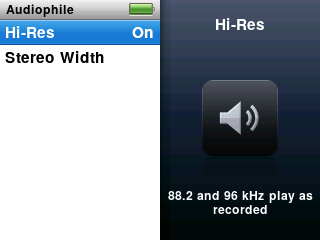
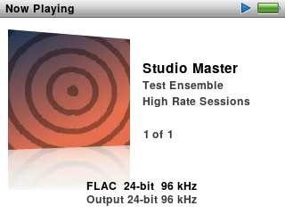

The iPod Video (5th generation and 5.5) can run three kinds of software. This page compares them, area by area:

- **Original software (1.3):** the software the player came with, in its last version, 1.3.
- **Rockbox 4.0:** the free, open-source firmware that ProkBox5g is built on, in its 4.0 release for this player.
- **ProkBox5g:** this project, as of the current release.

A ProkBox5g cell with a coloured tag is planned rather than finished. The tag shows where the item stands and the release it is planned for, and links to its entry on [What's coming](roadmap.md). The tags update with each release. Small numbers lead to notes at the end of the page. Rockbox can do more than we show here; these rows are the ones most people ask about.

## Music formats

| | Original software (1.3) | Rockbox 4.0 | ProkBox5g |
|---|---|---|---|
| MP3, AAC, WAV and AIFF | Yes | Yes | Yes |
| Apple Lossless (ALAC) | Yes | Yes | Yes |
| FLAC, Ogg Vorbis and Opus | No | Yes | Yes[^flac] |
| WMA, Monkey's Audio, WavPack, Musepack and many less common formats | No | Yes[^ape] | Yes |
| Music from game consoles and trackers (SPC, NSF, MOD and others) | No | Yes | Yes |
| Audible audiobooks (.aa) | Yes | No | No |
| Copy-protected songs from the iTunes Store | Yes | No | No |
| DSD (.dsf and .dff) | No | No |  |

## Gapless playback

| | Original software (1.3) | Rockbox 4.0 | ProkBox5g |
|---|---|---|---|
| No gap between tracks of a live or continuous album | Yes[^gap1] | Yes, for most formats[^gap] | Yes, for most formats[^gap] |

## Sound and equaliser

| | Original software (1.3) | Rockbox 4.0 | ProkBox5g |
|---|---|---|---|
| Ready-made equaliser presets (Rock, Jazz, Spoken Word and so on) | Yes | None included: you can save your own | Yes, 22 presets[^eq] |
| Your own equaliser settings | No | Yes: 10 bands, each fully adjustable |  |
| Even volume across songs | Sound Check | ReplayGain, by track or by album | Sound Check, using ReplayGain tags[^sc] |
| Crossfade between songs | No | Yes | No |
| Bass, treble, stereo width, crossfeed and other effects | No | Yes | No |
| Volume limit, with an optional code | Yes | Yes[^vlimit] | Yes |

## Bit depth and sample rates

Bit depth is how finely each moment of sound is stored, and sample rate is how many of those moments there are each second. Higher numbers can hold more detail.

| | Original software (1.3) | Rockbox 4.0 | ProkBox5g |
|---|---|---|---|
| Bit depth sent to the audio chip | Not published | 16-bit | FLAC, WAV and AIFF play at their full depth (24-bit); MP3 and AAC are sent at 16-bit. MP3 and AAC at 24-bit:  |
| Highest sample rate sent to the audio chip | Not published | 48 kHz | 48 kHz today. 88.2 and 96 kHz:  |
| Files above 48 kHz (such as 96 or 192 kHz FLAC) | Not published | Play, converted down to 44.1 or 48 kHz[^hrm] | Play, converted down[^hrm][^hr] |

## Getting music on and off

| | Original software (1.3) | Rockbox 4.0 | ProkBox5g |
|---|---|---|---|
| Putting music on | Synced from iTunes on a computer | Drag and drop over USB | Drag and drop over USB |
| Copying music back off, or sharing it | Only songs bought from the iTunes Store[^off] | Yes, the same way | Yes, the same way |
| Reads music an iTunes sync already put on the player | Yes | Plays the song files it finds, but not the iTunes library, covers or playlists[^rbitl] | Yes: songs and their covers[^itl] |
| Adds your music to the original software's library | Not applicable | No |  |

## Browsing and playlists

| | Original software (1.3) | Rockbox 4.0 | ProkBox5g |
|---|---|---|---|
| Browse by artist, album, genre and composer | Yes | Yes, from its music database[^db] | Yes |
| Search | Yes[^search] | Yes | Yes |
| Browse by folder | No | Yes | No |
| On-The-Go playlist, made on the player | Yes | A similar running playlist | Yes |
| Smart playlists (most played, recently played) | Yes, made in iTunes | Most played and recently played lists |  |
| Playlist files (.m3u) | No | Yes | Yes, from the Playlists folder at the top level of the player |

## Album art and Album Flow

| | Original software (1.3) | Rockbox 4.0 | ProkBox5g |
|---|---|---|---|
| Album art on Now Playing | Yes | Yes | Yes[^art] |
| Flip through your albums by their covers | No | With an add-on, PictureFlow[^pf] |  |

## Audiobooks

| | Original software (1.3) | Rockbox 4.0 | ProkBox5g |
|---|---|---|---|
| An Audiobooks menu | Yes | No | Yes |
| Chapters | Yes | No[^cue] | Yes, in .m4b and MP3 books |
| Each book remembers its place | Yes | With bookmarks or automatic resume | Yes |
| Playback speed | Slower, Normal or Faster[^speed] | 35% to 250%, at the same pitch, once turned on in the settings | Slower, Normal or Faster, at the same pitch |

## Podcasts

| | Original software (1.3) | Rockbox 4.0 | ProkBox5g |
|---|---|---|---|
| A Podcasts menu | Yes | No[^pod] | Yes[^podorder] |

## Video

| | Original software (1.3) | Rockbox 4.0 | ProkBox5g |
|---|---|---|---|
| H.264 video (.mp4, .m4v) | Yes, up to 320 × 240; up to 640 × 480 on the 5.5[^vid] | No | Yes, at 320 × 240[^conv] |
| MPEG-4 video | Yes, up to 480 × 480; up to 640 × 480 on the 5.5[^vid] | No |  |
| MPEG-1 and MPEG-2 video (.mpg) | No | Yes, with an add-on player |  |
| AVI, MKV and WebM files | No | No | AVI:  MKV and WebM:  |
| Video on a TV | Yes, with a cable or dock | No | No |

## Photos

| | Original software (1.3) | Rockbox 4.0 | ProkBox5g |
|---|---|---|---|
| Photo viewing and slideshows | Yes: photos synced from a computer, slideshows with music, also on a TV | An add-on image viewer (JPEG, PNG, BMP, GIF) with slideshows | Not at present; may return (no date) |

## Games and extras

| | Original software (1.3) | Rockbox 4.0 | ProkBox5g |
|---|---|---|---|
| Games | A few may have come on the player; more were sold in the iTunes Store, in some countries[^games] | Many, as add-ons | More games and game kits: [^extras] |
| Clocks, alarms, stopwatch and screen lock | Yes | Clock, alarm and stopwatch add-ons | Yes[^extras] |
| Calendars, contacts and notes | Yes, synced from a computer | A calendar add-on | Yes[^extras] |
| Making your own games and apps | No | Yes, as add-ons written in C or Lua |  |

## Languages and scripts

| | Original software (1.3) | Rockbox 4.0 | ProkBox5g |
|---|---|---|---|
| Menu languages | 21 | More than 40 | English. Dutch and German:  Japanese:  |
| Japanese, Chinese and Korean song names | Yes | Yes, once you choose a font that has the characters | Not yet. Japanese and Korean:  Chinese: no plan yet |

## Accessories and docks

| | Original software (1.3) | Rockbox 4.0 | ProkBox5g |
|---|---|---|---|
| Docks, speakers and car adapters on the dock connector | Yes | Partly[^iap] | The dock code is in the one download for every player[^dock] Behaving like the original:  |
| Remotes and the FM radio remote | Yes | Partly[^iap] | No |

## Battery and power

| | Original software (1.3) | Rockbox 4.0 | ProkBox5g |
|---|---|---|---|
| Sleeps when idle and wakes instantly (not a sleep timer) | Yes[^sleep] | No: a full start-up each time |  |
| Processor speed matched to the work | Not published | Yes | Yes |

We do not compare battery life: it depends on the player, its battery and how you use it.

## Look and feel

| | Original software (1.3) | Rockbox 4.0 | ProkBox5g |
|---|---|---|---|
| The look | The original 5th-generation menus | Its own look, which you can change with themes | Inspired by the look of Apple's later players, with our own fonts and artwork |
| Settings | A short list | Well over two hundred options | A short list, like the original |

Skins, plugins and the full settings menus are not coming to ProkBox5g; see [Not planned](roadmap.md#not-planned) for why.

## Installing and going back

| | Original software (1.3) | Rockbox 4.0 | ProkBox5g |
|---|---|---|---|
| Installing and updating | Comes on the player; updated through iTunes | Rockbox Utility, or by hand | Copy files, then run the install tool once[^install]. An installer:  |
| The original software stays available | Not applicable | Yes: slide Hold on, or hold Menu, as the player starts | Yes: slide Hold on and restart, or hold Menu as it starts |

## Open source and licence

| | Original software (1.3) | Rockbox 4.0 | ProkBox5g |
|---|---|---|---|
| Source code | Closed | Open | Open |
| Licence | Apple's own | GNU GPL v2 or later | GNU GPL v2 or later |
| Price | Came with the player | Free | Free |

## Previews: not released yet

These pictures come from the simulator we develop on, running work that is not in a release yet. Each one is planned for the release named under it, and may still change before it arrives.

**Optional 88.2 and 96 kHz output.** A new Settings › Audiophile menu. With Hi-Res on, music recorded at 88.2 or 96 kHz plays at its own rate once your player has passed a short self-test. 

**Format details in Now Playing.** One more press of the centre button shows the song's format, bit depth and sample rate, and what the player is sending to the headphones. Here a 24-bit, 96 kHz FLAC test file plays with Hi-Res on. 

[^flac]: 32-bit FLAC files are rare. They stay in your library but are skipped cleanly, because the player cannot play them. Playing them: 
[^ape]: In Rockbox, Monkey's Audio files play smoothly only at the Fast compression level. ProkBox5g is expected to be the same (not measured).
[^gap1]: Gapless playback arrived with software 1.2 in 2006. Apple did not say which formats it covers.
[^gap]: Not for WMA, AC3, RealAudio or the game-console formats. For ProkBox5g we are also checking Opus endings: 
[^eq]: Named like the presets on the later iPod classic. Presets make music quieter ().
[^sc]: ProkBox5g's Sound Check uses ReplayGain tags in your files. It does not read the loudness values iTunes stores.
[^vlimit]: Rockbox sets a maximum volume, without a code.
[^hrm]: How these files sound after the conversion has not been measured.
[^hr]: 192 kHz files used to cut out every few seconds. 0.8.3 should play them better, but we have not yet tried it with a 192 kHz album on a real player.
[^off]: iTunes copies back only songs bought from its store. Other music stays in hidden folders under coded names; the player's disk mode is meant for ordinary files.
[^rbitl]: Rockbox's music scan also walks the folders where iTunes keeps songs, so it finds and plays them by their tags. It does not read iTunes' own library files.
[^itl]: ProkBox5g only reads that library: it never changes what iTunes put there.
[^search]: Software 1.2 (September 2006) added Search to these players, and 1.3 is the last version for all of them. One report from 2006 said only the 5.5 had it. We have not confirmed this from Apple's own documents.
[^db]: Rockbox builds its database from your files' tags when you start a scan.
[^art]: From the picture inside the file first, then a picture file in the same folder, then covers an iTunes sync put on the player.
[^pf]: PictureFlow needs Rockbox's database and separate cover image files. It does not show pictures stored inside music files.
[^cue]: Rockbox can use a cue sheet to mark points inside one long file, but it does not read the chapters stored in .m4b or MP3 books.
[^speed]: For audiobooks bought from the iTunes Store or Audible.
[^pod]: Rockbox can remember the place in each file, but has no menu for podcasts.
[^podorder]: Ordering episodes by their release date, even when you copied them all at once: 
[^vid]: H.264 up to 768 kbit/s at 320 × 240, and MPEG-4 up to 2.5 Mbit/s at 480 × 480, from Apple's published specifications. The 5.5 also plays H.264 at up to 1.5 Mbit/s at 640 × 480.
[^conv]: Videos play once converted with the free converter that comes with ProkBox5g. Subtitles show only when burned into the picture; separate subtitles: 
[^games]: Older iPods came with a few built-in games, and software 1.2 added games bought from the iTunes Store. Which games came on a player running 1.3 is not confirmed.
[^extras]: The Extras menu is on the player today, with clocks, alarms, a stopwatch, screen lock, notes, contacts and calendars. The fuller set of extras and the games:  The kits for making your own games start with 
[^dock]: The one download includes the dock code on every player, but it has not been tested on a player that still has the original dock connector.
[^iap]: Rockbox partly supports the dock connector's accessory protocol. Some accessories work and some do not.
[^sleep]: From how these players are widely known to behave; Apple's documents we have do not describe it.
[^install]: A one-time step of about 20 minutes. [Getting started](guide/getting-started.md) explains it.
