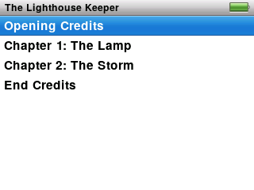
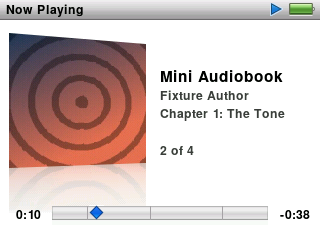

Audiobooks have their own list, and ProkBox remembers where you are in every book separately.

## Listening

1. Choose **Music**, then **Audiobooks**. (You can also add Audiobooks to the main menu in **Settings › Main Menu**.)
2. The book you listened to most recently is at the top, so getting back to it never needs scrolling.
3. Choose a book. Its page lists the chapters. Once you've listened to part of it, a **Resume** row appears at the top.
4. Choose **Resume** to carry on where you stopped, or choose a chapter to start there.

<!-- screenshot: scripts/shots.sh tests/ui/ipodui-p4-audiobooks.script -->

Starting a book plays only that book, not the whole list.

## On Now Playing

<!-- screenshot: scripts/shots.sh tests/ui/ipodui-p5-audiobook.script -->

- The bar covers the **whole book**, with small tick marks where chapters start.
- The line under the title shows the current chapter, and a counter such as "3 of 12".
- If a book has pictures for its chapters, you see the one for the current chapter.
- **Next** / **Previous** jump a whole chapter, not a few seconds.
- **Select** steps through the scrubber and the rating (no shuffle for books). Turning the wheel quickly in the scrubber snaps from chapter to chapter, which is handy for crossing a long book.
- Turn the wheel in the normal view for volume.

## Resume

Close the book, play music, switch the player off: your place in each book is kept. Open the book again and choose **Resume**.

## Speed

1. Go to **Settings › Audiobooks**.
2. Choose **Slower**, **Normal** or **Faster**.

The voice speeds up or slows down without changing pitch, so it does not sound squeaky or deep.
