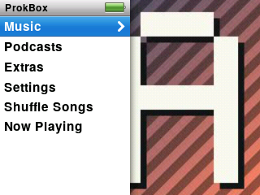
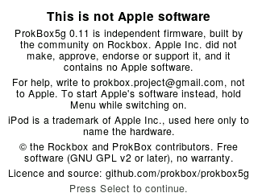

## What ProkBox is

ProkBox5g is free, community-made software for the iPod Video (5th generation and 5.5). It replaces the music player on your device with a fresh one that looks and feels familiar, plays almost any audio file, and treats audiobooks properly.

With it you can:

- drag music onto the player from your computer, with no sync program, and drag it back off again;
- play almost any common music format;
- listen to audiobooks with chapters, a saved place in every book, and a speed you choose;
- watch videos you have converted for the small screen.

ProkBox5g is not Apple software. It is an independent, community-driven fork of Rockbox, and Apple Inc. has not made, approved, endorsed or supported it in any way. For help, ask the ProkBox community (prokbox.project@gmail.com), not Apple.

<!-- screenshot: scripts/shots.sh tests/ui/ipodui-nav-panels.script -->

## Pick the right download

Each release comes as several zip files. Choose the one that matches your player. You need to answer three questions.

| Question | Choices |
|---|---|
| Is the battery original or a bigger replacement? | Stock, or modded |
| Is the storage a hard drive, or flash (an SD, CF or similar adapter)? | Hard drive, or flash |
| How much memory? | 32 MB or 64 MB |

Not sure? These tips help:

- **Hard drive or flash:** if you opened the player and swapped the drive for a memory-card adapter, it is flash. If you never opened it, it is a hard drive.
- **32 or 64 MB:** the 30 GB models have 32 MB. The 60 GB and 80 GB models have 64 MB. Flash-modded players keep the memory they started with, so go by the original capacity.
- **Battery:** if you have never replaced it, choose stock.

> [!TIP]
> If you picked the wrong one, install the right one over it. Your music stays where it is.

## Before you install

> [!WARNING]
> Back up your music first. If anything on the player exists nowhere else, copy it to your computer before you start.

1. Charge the player.
2. Make sure it is formatted for Windows (FAT32). If it is not, the install steps will tell you, and changing it erases the player.

## Install

There is no installer app yet. You install in two parts, by hand: first the start-up program, then the ProkBox files. Set aside about 15 minutes. You need the free `ipodpatcher` tool, which is available for macOS, Windows and Linux.

1. Download the zip that matches your player and unzip it on your computer.
2. Connect the player and make sure its drive shows up. Check it is formatted for Windows (FAT32).
3. **Save a copy of the original start-up files.** In a terminal, run `ipodpatcher -r ProkBox-backup.bin` and keep that file somewhere safe. It is what lets you undo the install later.
4. **Install the start-up program.** Run `ipodpatcher -a bootloader-ipodvideo.ipod`, using the `bootloader-ipodvideo.ipod` file from the zip. It asks for your computer's administrator password.
5. **Copy the ProkBox files.** Open the zip's folder and copy everything in it onto the top level of the player's drive, including the folder whose name starts with a dot. Those folders are hidden by default, so turn on "show hidden files" first (Finder: **Cmd+Shift+.**; Windows Explorer: View › Show › Hidden items).
6. Eject the player from your computer and unplug it. It restarts into ProkBox.

> [!NOTE]
> Apple's own software stays on the player. If you ever want it back, see [Going back](going-back.md).

## First start

The first time you start, and again after each new version, you see a short notice. It says ProkBox is independent software, who to ask for help, and where the licence and source code are. Read it, then press **Select**. The button does nothing for the first 3 seconds, so you can't skip past it by accident. You can read it again later in **Settings › Legal**.

Then you see the main menu. Move with the wheel, press **Select** to choose, and press **Menu** to go back.

<!-- screenshot: scripts/shots.sh tests/ui/ipodui-legal-notice.script -->
