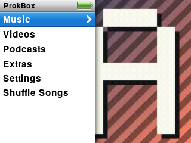
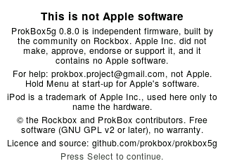

## What ProkBox is

ProkBox5g is free, community-made software for the iPod Video (5th generation and 5.5 generation). It replaces the music player on your device with a fresh one that looks and feels familiar, plays almost any audio file, and treats audiobooks properly.

With it you can:

- drag music onto the player from your computer, with no sync program, and drag it back off again;
- play almost any common music format;
- listen to audiobooks with chapters, a saved place in every book, and a speed you choose;
- watch videos you have converted for the small screen.

ProkBox5g is not Apple software. It is an independent, community-driven fork of Rockbox, and Apple Inc. has not made, approved, endorsed or supported it in any way. For help, ask the ProkBox community (prokbox.project@gmail.com), not Apple.

<!-- screenshot: scripts/shots.sh tests/ui/ipodui-nav-panels.script -->

## Pick the right download

Each release comes as eight zip files, named `ProkBox5g-<version>-{stock,modded}-{flash,hdd}-{32,64}MB.zip`. Choose the one that matches your player. You need to answer three questions.

| Question | Choices |
|---|---|
| Which hardware changes does the player have? | `stock`: none, original battery and the 30-pin dock connector. `modded`: all of a 3000 mAh battery, a USB-C port in place of the dock connector, and a haptic motor |
| Is the storage a hard drive, or flash (an SD, CF or similar adapter)? | `hdd` or `flash` |
| How much memory? | `32MB` or `64MB` |

> [!NOTE]
> 0.8.0 includes all eight downloads, but only **flash, 64 MB, modded (USB-C with haptics)** has been tested on a real player. The other seven are untested. They should work, and reports from them are very welcome.

"Modded" is one choice that stands for all three changes together. If your player has only some of them (for example a bigger battery but the original dock connector), no download fits exactly. Pick the one that matches the battery, and expect the USB icon or the haptic tap to be wrong. Tell us which mix you have.

How to tell:

- **Hard drive or flash:** if you opened the player and swapped the drive for a memory-card adapter, it is flash. If you never opened it, it is a hard drive.
- **32 or 64 MB:** the 30 GB models have 32 MB. The 60 GB and 80 GB models have 64 MB. Flash-modded players keep the memory they started with, so go by the original capacity. Once you have `ipodpatcher` (see below), `ipodpatcher -l` also prints the model and, where it can tell, the memory.
- **Right player:** this firmware is only for the iPod Video (5th generation and 5.5 generation, "5G" and "5.5G"). Never put it on an iPod Classic, nano, mini or any other model.

> [!WARNING]
> A wrong pick can leave the player running with the wrong battery gauge, buffer sizes or memory use, or fail to start. If that happens, put the right zip's files over the top (see "Updating" below); your music stays where it is. Do not guess "hard drive, 32 MB" for a unit you are unsure about; check first.

## Before you install

> [!WARNING]
> Back up your music first. If anything on the player exists nowhere else, copy it to your computer before you start.

1. Charge the player fully, and keep it plugged in to the computer's power throughout. Do not unplug it or put the computer to sleep while any step below is running.
2. Check the format. The player must be in Windows format (FAT32).
   - **Windows:** in File Explorer, right-click the player's drive, choose Properties, and read "File system". It must say FAT32.
   - **macOS:** select the player in Finder and choose Get Info, or look in Disk Utility. "MS-DOS (FAT32)" is right. "Mac OS Extended" or "HFS+" is the Mac format.
   - **Linux:** `lsblk -f` shows `vfat` for the right format and `hfsplus` for the wrong one.
3. **A player in Mac format is not supported by these steps.** The patching tool refuses to touch it. You must first restore it to Windows format with Apple's own tools (iTunes on Windows is the proven way), which erases the player completely. Do that, copy your music back, and then start here. We do not support converting it with `ipodpatcher -c`.
4. Download the zip and check it (next section). Turn off any music-library program that opens by itself when the player is connected (iTunes or Music) and make sure it is closed. On Windows, also turn off its automatic sync for this player, since it can rewrite the player when you connect it.

## Check your download

Each release page lists a `SHA256SUMS` file. After downloading, compute the zip's checksum and compare it with the matching line in that file. Every character must match. If it does not, download again.

- **macOS and Linux:** `shasum -a 256 ProkBox5g-0.8.0-modded-flash-64MB.zip` (on Linux you can also use `sha256sum`).
- **Windows (Command Prompt or PowerShell):** `certutil -hashfile ProkBox5g-0.8.0-modded-flash-64MB.zip SHA256`

Use your own file's name in place of the example. 0.8.0 is marked as a pre-release on the download page.

## Get ipodpatcher

You need the free `ipodpatcher` command-line tool, which writes the start-up program. It is not inside the player zip, but it is on the same download page, ready to run. Pick the one for your computer:

- **macOS (Apple silicon and Intel):** `ProkBox5g-<version>-ipodpatcher-macos-universal`
- **Windows (64-bit):** `ProkBox5g-<version>-ipodpatcher-windows-x86_64.exe`
- **Linux (64-bit):** `ProkBox5g-<version>-ipodpatcher-linux-x86_64`

Check it against `SHA256SUMS` as above. Save it in the same folder as the unzipped files and, to match the commands below, rename it to `ipodpatcher` (`ipodpatcher.exe` on Windows). On macOS and Linux make it runnable once with `chmod +x ipodpatcher`, and run it as `./ipodpatcher` unless you put it on your path. These tools are built unmodified from the source download (`ProkBox5g-<version>-source.tar.gz`, folder `utils/ipodpatcher`), and it is a general tool that other projects also use, so its output mentions "Rockbox" and its author; that is expected.

> [!NOTE]
> **Advanced: build it yourself.** Unpack the source download, run `make -C utils/ipodpatcher` (a C compiler is needed), and use the `ipodpatcher` it produces. Build it without `BOOTOBJS`; the commands here give it the start-up file from the zip.

`ipodpatcher` needs raw access to the disk, so run it with the right privileges. It does not ask for a password by itself; without them it just reports "No iPods found".

- **macOS and Linux:** put `sudo` in front of every `ipodpatcher` command below.
- **Windows:** open the Start menu, type `cmd`, right-click Command Prompt and choose "Run as administrator". Use that window for every command, after changing into the folder that holds `ipodpatcher.exe` and the unzipped files (`cd` followed by the folder's path).
- **macOS:** the downloaded tool is not signed by a registered developer and may be blocked. If so, allow it under System Settings › Privacy & Security, or remove the download mark with `xattr -d com.apple.quarantine ipodpatcher`; or build it yourself (see the advanced note above).
- **Linux:** run it with `sudo`; the player appears as a disk such as `/dev/sdb`. Check with `lsblk` that you are pointing at the player and nothing else. We have not tried these steps on Linux for 0.8.0 yet; reports are welcome.

Connect only one iPod at a time.

## Install

There is no installer app in 0.8.0. You install by hand, in this order: save a backup, copy the ProkBox files and check them, then add the start-up program last. Set aside about 20 minutes.

> [!WARNING]
> Take the firmware-partition backup **once**, on a player that has never had ProkBox installed. Never run it again on an installed player: that would overwrite the good backup with a copy of the ProkBox start-up program, and restoring it later would put ProkBox back instead of Apple's software. Put a date in the name and keep the file somewhere safe, one per player.

1. Unzip the download.
2. Connect the player. Hold **Select** and **Play** during a restart to enter Disk Mode if it does not show up.
3. **macOS only:** unmount, without ejecting, so the tool can reach the disk. Find the disk with `diskutil list` (the iPod is the external disk, for example `/dev/disk4`), then run `diskutil unmountDisk /dev/disk4` with your own number. Never use any `diskutil` erase or format option. Make sure Music or iTunes did not open again.
4. **Save a backup of the firmware partition**, once: `ipodpatcher -r ProkBox-backup-2026-11-06.bin` (use today's date; with `sudo` or from the Administrator window). The file is written to the folder you are in. Check that it exists and is not empty. Copy it to your computer's safe place.
5. **Copy the ProkBox files first.** On macOS, unplug and reconnect the player so the drive mounts again. Show hidden files (Finder: **Cmd+Shift+.**; Windows Explorer: View › Show › Hidden items; Linux file manager: **Ctrl+H**). Copy the folder whose name starts with a dot onto the top level of the player's drive, and the other files from the zip except `bootloader-ipodvideo.ipod` (you will use that in step 7, and it does not need to go on the player). Wait until the copy finishes.
6. **Check the copy.** Compare the folder's size and file count with the unzipped one, and open a few files. If a copy was interrupted or you are unsure, delete the dot-folder from the player and copy it again. Nothing is lost by repeating it, because the start-up program is not installed yet, so the player still starts normally.
7. **Install the start-up program.** On macOS, unmount again as in step 3. Then run `ipodpatcher -a bootloader-ipodvideo.ipod`. Use `-a`, not `-ab`: `-a` is for `.ipod` files. Apple's firmware stays on the player.
8. When it says it finished, eject the player from the computer, unplug it and let it restart. It starts into ProkBox.

If anything fails halfway, do not unplug: read the message, and run the same command again once. If the player will not start afterwards, see "If it will not start" below.

> [!NOTE]
> Apple's own software stays on the player. If you ever want it back, see [Going back](going-back.md).

## Updating

To move to a newer version, you only replace the files. You do not repeat the backup or the start-up program step.

1. Download and check the new zip for the same variant.
2. Connect the player, show hidden files, and copy the new zip's dot-folder and files over the old ones, agreeing to replace them. Your settings, library, play counts and resume points are kept.
3. Eject and restart. The first-start notice appears again.

Run `ipodpatcher` again only if the release notes say the start-up program changed.

## If it will not start

- Slide the **Hold** switch to its on position and restart, or hold **Menu** during the restart. Either one starts Apple's software instead. If you see Apple's screen after Hold was on, ProkBox is probably fine: slide Hold off and restart again.
- If the screen shows a message that a file can't be loaded, the ProkBox files are missing or incomplete. Start Apple's software as above, connect the player, copy the files again (steps 5 and 6) and restart.
- To remove the start-up program without the backup file, see [Going back](going-back.md).

## First start

The first time you start, and again after each new version, you see a short notice. It says ProkBox is independent software, who to ask for help, and where the licence and source code are. Read it, then press **Select**. The button does nothing for the first 3 seconds, so you can't skip past it by accident. You can read it again later in **Settings › Legal**.

Then you see the main menu. Move with the wheel, press **Select** to choose, and press **Menu** to go back.

<!-- screenshot: scripts/shots.sh tests/ui/ipodui-legal-notice.script -->
