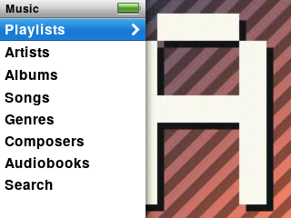

## Finding something to play

Choose **Music** on the main menu. You will see these lists:

- **Playlists** (including On-The-Go, described below)
- **Artists**, **Albums**, **Compilations**, **Songs**, **Genres**, **Composers**
- **Audiobooks** (see [Audiobooks](audiobooks.md))
- **Search**

Turn the wheel to move, press **Select** to open something, and **Menu** to go back. In a long list, spin the wheel fast and a big letter appears so you can jump to that part of the alphabet. A small speaker mark on the right shows which song is playing.

<!-- screenshot: scripts/shots.sh tests/ui/ipodui-nav-panels.script -->

**Search:** pick **Search**, then use the wheel to choose letters. Results appear as you type.

**Shuffle Songs** is on the main menu. Choose it to play your whole library in random order.

## Now Playing

Start a song and you land on **Now Playing**. It shows the cover, title, artist, album, how far through the song you are, and the time left.

<!-- screenshot: scripts/shots.sh tests/ui/ipodui-p5-rating.script -->

- **Wheel:** volume.
- **Play/Pause:** pause and resume.
- **Next** / **Previous:** tap to skip. Press and hold to fast-forward or rewind inside the song.
- **Select:** step through extra controls, in this order:
  1. **Scrubber.** Turn the wheel to slide to another point in the song. It jumps there when you stop turning.
  2. **Rating.** Turn the wheel clockwise to give 1 to 5 stars, or counter-clockwise to remove them.
  3. **Shuffle.** Choose **Off**, **Songs** or **Albums**.
  4. **Lyrics**, only if the song has lyrics saved in it. Turn the wheel to scroll.
  5. **Visualiser** (see below).
  6. Back to normal.

  If you do nothing for a few seconds, it returns to the normal view by itself.

If you leave a menu untouched while music plays, Now Playing comes back on its own after a short while. Press **Menu** to return to where you were.

## The visualiser

The visualiser fills the screen with moving pictures that follow the music. To use it, press **Select** on Now Playing until the extra controls reach the visualiser step. The screen stays lit while it shows.

- **Change the style:** press and hold **Select** to pick one of five: Bars, Mirror, Scope, Spectrogram and Radial. The player remembers your choice.
- **Volume:** turn the wheel; a volume bar shows for a moment.
- **Leave:** press **Select**.

<!-- screenshot: scripts/shots.sh tests/ui/ipodui-p19-viz.script -->

Showing the visualiser uses more battery than normal playing, because the screen stays on.

## Ratings

Rate songs on Now Playing as described above. Ratings are saved on the player and show up in the song's info.

## On-The-Go playlists

An On-The-Go playlist is one you build on the player itself.

1. Find a song and press and hold **Select** on it (or on Now Playing). A menu opens.
2. Choose **Add to On-The-Go**.
3. Open **Music › Playlists › On-The-Go** to play or look at your list.

The same hold menu also has **Browse Album** and **Browse Artist**, to jump straight to the rest of that album or artist, and **Cancel**.

## Shuffle and repeat

Set them on Now Playing (**Select**, shuffle step), or any time in **Settings** (see [Settings](settings.md)). Shuffle can be **Off**, **Songs** or **Albums**.
