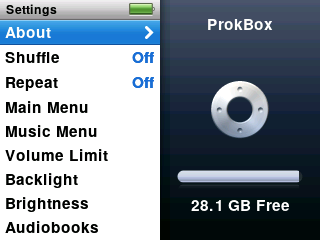

Choose **Settings** on the main menu. Turn the wheel to pick a row; the right side of the screen shows a short description or the current value.

<!-- screenshot: scripts/shots.sh tests/ui/ipodui-p8b-settings.script -->

| Setting | What it does |
|---|---|
| **About** | Shows how full the player is, counts of songs and more, and the version. The last page has **Save Diagnostics** (see [Troubleshooting](troubleshooting.md)). Use **Next** and **Previous** to change pages. |
| **Shuffle** | Off, Songs or Albums. Press **Select** to change. |
| **Repeat** | Choose how repeat works. Press **Select** to change. |
| **Main Menu** | Choose which items appear on the main menu, such as Audiobooks. |
| **Music Menu** | The same for the Music menu. |
| **Volume Limit** | Set a top volume so it can't go too loud. |
| **Backlight** | How long the screen stays lit: Off, 2, 5, 10, 20 or 30 seconds, or Always On. |
| **Brightness** | Turn the wheel to make the screen brighter or dimmer. |
| **Audiobooks** | Playback speed: Slower, Normal or Faster. |
| **EQ** | Choose a sound preset. |
| **Sound Check** | Evens out loudness between songs. |
| **Clicker** | The small tick you feel and hear as you scroll. On or Off. |
| **Date & Time** | Set the clock. |
| **Sort By** | How lists such as artists and albums are ordered. |
| **Language** | Choose the language. |
| **Legal** | Reads the licence notice again. |
| **Reset Settings** | Puts every setting back to how it started. Your music is not touched. |

Video options are under **Videos › Settings** (see [Video](video.md)).

## The screen when idle

When the backlight turns off, the screen switches to a plain black-and-white clock you can read in daylight, with a battery symbol and a play or pause mark. Press any button to wake it. After about a minute of that, the screen goes fully dark to save power.

Sliding the **Hold** switch on locks the buttons.
