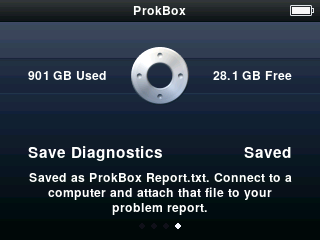

## Quick fixes

**The player is frozen or acting strangely.** Slide the **Hold** switch on and off, then hold **Menu** and **Select** together for about 8 seconds until it restarts. Your music and settings are safe.

**A song or book I copied doesn't appear.**
1. Make sure you ejected the drive on your computer before unplugging.
2. Wait a minute; a small "Updating Library..." row may still be working.
3. Check the file is a normal audio file. If you can't tell, try playing it on your computer.
4. Plug the player in again and copy the file once more.

**Cover pictures are missing.** They are made after the songs show up. Give it a little while, and leave the player alone on its own for a bit.

**A video won't play.** Read the reason on the **Can't Play Video** screen, then see [Making videos that play well](video-converter.md).

**The battery runs down fast.** The visualiser and a backlight set to Always On use the most power. Shorten **Settings › Backlight**.

**Your computer doesn't show the drive.** Try another USB cable or port. Wait for the **Connected** screen to appear first.

## Send us a report

If something is wrong and the fixes above don't help, we want to know. The player can write a short report for you.

1. Choose **Settings › About**.
2. Move to the last page (press **Next** until the page shows **Save Diagnostics**).
3. Press **Select**. It says "Saving...", then "Saved".
4. Connect the player to your computer. At the top level of the drive you'll find a text file called `ProkBox Report.txt`.
5. Email it to **prokbox.project@gmail.com**, or attach it to an issue on the project's tracker. Tell us what you were doing, what you expected, and what happened.

The report has the version, the hardware details (storage, memory, battery), how many songs, podcasts and audiobooks there are (counts only), and a short log. It never contains your music, file names or personal information. It only ever saves when you ask, and each save replaces the last.

<!-- screenshot: scripts/shots.sh tests/ui/ipodui-diag-report.script -->

## Still stuck, or want Apple's software back

See [Going back](going-back.md).
