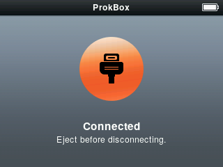

You don't need a sync program. The player shows up on your computer as an ordinary drive, and you move files by dragging them.

## Put music on the player

1. Connect the player to your computer.
2. The player shows a **Connected** screen with the words "Eject before disconnecting." Your computer shows a new drive.
3. Open the drive and drag in your music, audiobooks and converted videos. Folders are fine; you don't need a special layout.
4. **Eject** the drive from your computer (right-click it, or use the eject button).
5. Unplug the cable.

<!-- screenshot: scripts/shots.sh tests/ui/ipodui-p8a-usb.script -->

While files are being copied, the symbol on the screen turns into two spinning arrows. When it settles, the copy is finished.

## Copy music back off, or share it

It works the same way in reverse. Connect the player, open the drive, and drag the files to your computer. There is no hidden or protected copy to worry about.

## The library updates itself

After you unplug, the player notices the new files and updates its lists. A small "Updating Library..." row shows while it works. You can keep using the player, and playback is not interrupted. The first update after a big copy takes longest.

New cover pictures appear a little after the songs do.

## Good habits

- Always eject before unplugging. Pulling the cable early can leave a file half-copied.
- If you are listening to music while you plug in, that is fine; the player takes care of it.
- The player charges over USB while connected.

If a song doesn't show up, see [Troubleshooting](troubleshooting.md).
