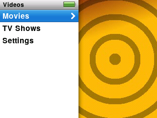
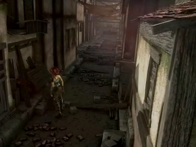

The player's picture is small, so it plays videos best when they are converted first. Converting is quick and free; see [Making videos that play well](video-converter.md). Videos you have converted show up on their own after you copy them over.

## Finding and playing

Choose **Videos** on the main menu. It has:

- **Movies**: a list with posters.
- **TV Shows**: pick a show, then a season, then an episode.
- **Settings**: video options (below).

Podcasts that are videos appear in the **Podcasts** list among the audio ones, marked with a small screen symbol.

<!-- screenshot: scripts/shots.sh tests/ui/ipodui-p14a-menu.script -->

Choose a title to start. Videos remember where you stopped, and by default start again from that spot.

## The controls

<!-- screenshot: scripts/shots.sh tests/ui/ipodui-p14a-play.script -->

- **Play/Pause:** pause and resume.
- The wheel: volume.
- **Select**, while paused: show or hide a bar at the bottom with the time played, the time left and chapter marks. Press it again to slide to another point with the wheel.
- **Next** / **Previous:** jump to the next or previous chapter, if the video has chapters.
- **Menu:** stop and go back to the list. Your place is kept.

> [!NOTE]
> Videos need to be converted first. Anything else may show the Can't Play Video screen.

## Settings for video

Go to **Videos › Settings**:

- **Start Playing:** **Where Left Off** (the default) or **From Beginning**.
- **Fit to Screen:** on or off. Videos made with our converter are already the right size, so you will see no difference.

## Making videos

Use the converter. It handles movies, TV episodes and podcasts, can fill the screen or add black bars, and can burn subtitles into the picture. Step-by-step: [Making videos that play well](video-converter.md).

## If a video won't play

You see **Can't Play Video** and a short reason. The converter page explains each one, and what to do next. If it keeps happening, see [Troubleshooting](troubleshooting.md).
