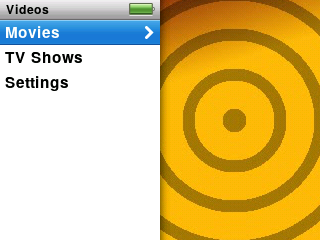
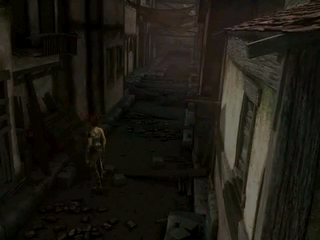

The player's picture is small, so it plays videos best when they are converted first. Converting is quick and free; see [Making videos that play well](video-converter.md). Videos you have converted show up on their own after you copy them over.

## Finding and playing

Choose **Videos** on the main menu. It has:

- **Movies**: a list with posters.
- **TV Shows**: pick a show, then a season, then an episode.
- **Settings**: video options (below).

Podcasts that are videos appear in the **Podcasts** list among the audio ones, marked with a small screen symbol.

<!-- screenshot: scripts/shots.sh tests/ui/ipodui-p14a-menu.script -->

Choose a title to start. Videos remember where you stopped, and by default start again from that spot.

## Videos are separate from your music

Videos start and resume only from **Videos**, never from anywhere else.

- **Play** and **Now Playing** are for sound only: music, audiobooks and audio podcasts. A video never becomes the song that Play resumes or the Now Playing screen.
- **Each video keeps its own place.** Leave a video and the next time you choose it, it carries on from where you stopped. That place is kept through a pause, the screen going dark, Hold, sleep, a flat battery and a USB connection.
- **A video's sound never plays on behind the menus.** When you leave the video screen, the picture and the sound stop together.
- **Starting a video stops the music.** Afterwards the music stays stopped; press **Play** and it carries on where it left off.
- **The screen stays lit while a video plays.** While it is paused, the usual backlight timeout applies.

## The controls

<!-- screenshot: scripts/shots.sh tests/ui/ipodui-p14a-play.script -->

- **Play/Pause:** pause and resume.
- The wheel: volume.
- **Select**, while paused: show or hide a bar at the bottom with the time played, the time left and chapter marks. Press it again to slide to another point with the wheel.
- **Next** / **Previous:** jump to the next or previous chapter, if the video has chapters.
- **Menu:** stop and go back to the list. Your place is kept.

> [!NOTE]
> Videos need to be converted first. Anything else may show the Can't Play Video screen.

## Settings for video

Go to **Videos › Settings**:

- **Start Playing:** **Where Left Off** (the default) or **From Beginning**.
- **Fit to Screen:** on or off. Videos made with our converter are already the right size, so you will see no difference.

## Posters

A poster is the picture shown for a video in the lists. Today the player uses the first of these it finds:

1. a picture saved inside the video file (the converter can put one there with `--poster`);
2. a picture with the same name as the video, next to it: `Film Name.m4v` and `Film Name.jpg`;
3. a picture called `poster.jpg` in the same folder as the video.

> [!NOTE]
> Coming later: poster and art folders for whole TV shows and seasons, and one folder per film. They are planned and are not in 0.8.0, so for now give each video its own poster by one of the three ways above.

## Subtitles

Subtitles you can switch on and off are not supported yet. You can burn them into the picture with the converter (see below).

## Making videos

Use the converter. It handles movies, TV episodes and podcasts, can fill the screen or add black bars, and can burn subtitles into the picture. Step-by-step: [Making videos that play well](video-converter.md).

## If a video won't play

You see **Can't Play Video** and a short reason. The converter page explains each one, and what to do next. If it keeps happening, see [Troubleshooting](troubleshooting.md).
