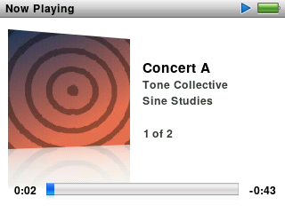

This is an **alpha**: an early look at ProkBox5g, free firmware for the iPod Video (5th generation and 5.5), for people who are happy to try unfinished software. It runs well on the unit we have tested, but expect rough edges. The first full pre-release, 0.8.0, follows.

> [!WARNING]
> **Back up first.** Copy any music or files you don't have anywhere else off the iPod before you install.

## Quick start

1. **Back up** anything on the iPod that you don't have elsewhere.
2. **Pick the right zip** (see [Which file do I need?](#which-file-do-i-need) below). In one line: 30 GB models originally had 32 MB (take **32MB**), 60 and 80 GB models have 64 MB (take **64MB**); an original hard drive takes **hdd**; an untouched iPod takes **stock**. If the drive was replaced, go by the model it was sold as (the model number on the back).
3. **Install the start-up program** with the free `ipodpatcher` tool: first save Apple's start-up files with `ipodpatcher -r ProkBox-backup.bin` (keep that file safe), then run `ipodpatcher -a bootloader-ipodvideo.ipod` with the file from the zip.
4. **Unzip onto the iPod's drive**: copy everything in the zip to the top level of the drive, including the hidden folder whose name starts with a dot (turn on "show hidden files" first).
5. **Eject and restart.** The iPod starts into ProkBox.
6. **Read the first-run notice**, then press **Select** once its short countdown ends.
7. **To go back to Apple's software at any time**, hold **Menu** while the iPod switches on.

The full, step-by-step instructions are in the guide's [Getting started](../guide/getting-started.md) chapter, and the whole [user guide](../guide/_index.md) covers everything else.

## A quick look

  

  

*Screenshots from the simulator, with a made-up music library. Video frame: Sintel, © Blender Foundation, durian.blender.org, licensed under CC BY 3.0.*

## What's in it so far

Compared with the iPod Video's own software:

- **Menus in the style of the last classic iPods**: split-screen menus with drifting album art, smooth scrolling lists, Search, the hold-**Select** menu and On-The-Go playlists.
- **Now Playing** with cover art and its reflection, ratings, and a **Select** button that steps through the scrubber, rating, shuffle, lyrics and the visualiser.
- **Every format Rockbox plays**: MP3, AAC, ALAC, FLAC, Ogg Vorbis, Opus, WAV and many more.
- **Audiobooks done properly**: chapters (m4b, MP3 and cue files), a separate resume point for every book, slower or faster playback without the voice changing pitch, chapter pictures, and the book you're listening to kept at the top of the list.
- **Podcasts** with the classic unplayed dot.
- **Drag and drop over USB**: copy music on and off with your computer's file manager. No sync app; the library updates by itself after you eject.
- **A visualiser** on Now Playing, drawn by the iPod's video chip.
- **Video playback** for files made with the converter described in the guide.
- **Sound**: EQ presets, run on the iPod's own audio chip wherever it can match them, plus Volume Limit and smooth fades.
- **Extras**: clocks, alarms, sleep timer, stopwatch, screen lock, notes, contacts, calendars and games, including Chess.
- **Battery care**: playback with the screen off runs on one processor core, and the iPod checks the battery before it starts up.
- **Save Diagnostics** (Settings › About) writes a report you can attach to a bug report.
- **Crash-safe settings**: changes are saved within a couple of seconds, and a power cut can't leave them half written.
- Apple's own software stays on the iPod as the way back.

## Which file do I need?

There are eight zips. The name tells you which one fits your iPod:

`ProkBox5g-0.7.0-alpha-` **stock** or **modded** `-` **flash** or **hdd** `-` **32MB** or **64MB** `.zip`

- **stock** if your iPod has its original-size battery and its 30-pin dock connector; **modded** for a larger (3000 mAh) battery, a USB-C port and a haptic clicker.
- **hdd** for the original hard drive; **flash** if the drive has been swapped for a memory-card adapter.
- **32MB** for models sold as 30 GB (they originally had 32 MB); **64MB** for models sold as 60 GB or 80 GB (64 MB). If the drive was replaced, go by the model it was sold as (the model number on the back).

If you choose the wrong one, install the right one over it; your music stays where it is. Each zip contains the ProkBox start-up program (`bootloader-ipodvideo.ipod`) and the ProkBox files.

## Going back to Apple's software

Apple's own software stays on your iPod.

- **For one start:** hold **Menu** while the iPod switches on.
- **For good, keeping your music:** write back the start-up backup you made when installing, with `ipodpatcher -w ProkBox-backup.bin`. The [Going back](../guide/going-back.md) chapter has the details.

## Known issues

All of these were seen on a test unit:

- The visualiser froze once for about two minutes, then carried on by itself.
- Video pictures can stop after about 10 minutes while the sound carries on. Scrubbing, or closing and reopening the video, brings the picture back.
- Chess can crash after about 10 moves.
- Videos that weren't made with the converter may play less smoothly.
- Album art can take a few minutes to appear after the first start or a big music copy, while it's built in the background.

Tested so far on a flash-modded 5.5 generation iPod with 64 MB. Hard-drive and 32 MB owners: your reports help most.

## Tell us how it went

Open a [tester report or bug report](https://github.com/prokbox/prokbox5g/issues/new/choose), or write to prokbox.project@gmail.com. A diagnostics report (Settings › About › Save Diagnostics) helps a lot.
