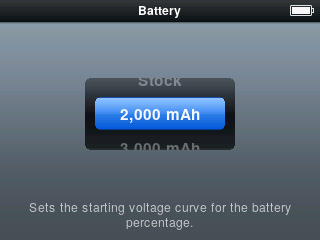
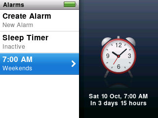

ProkBox5g 0.8.3 reworks the playback engine and tidies up a lot around it. All music is now decoded on the player's second processor, FLAC is faster, and 24-bit FLAC, WAV and AIFF files keep their full depth. There is one download for every iPod Video, the player asks which battery is fitted, Alarms says when each alarm next rings, and album art is built faster. The rest is fixes: for FLAC files, skipped songs, Hold during a video, sleep, USB and a few rare freezes. Some of these fixes have been proven in the simulator and an emulator but not yet on a real player; those are worded with "should" below. Your music, settings, places in books and videos, and playlists are kept when you update.

> [!NOTE]
> ProkBox5g is not Apple software. It is an independent, community-driven fork of Rockbox, and Apple Inc. has not made, approved, endorsed or supported it in any way. It contains no Apple software. iPod is a trademark of Apple Inc.

## What is new

- **Faster FLAC decoding.** The FLAC decoder does less work for each block of sound, most of all for high-quality 24-bit files, so they need less processor time to play.
- **Less waiting between the two processors.** WMA files, and AAC files such as M4A songs and M4B audiobooks, now read their small pieces of bookkeeping straight from memory instead of asking the other processor for each one. Starting and playing these tracks takes far fewer of those hand-overs.
- **The processor speed follows the music.** The player now watches both of its processors when it picks its speed, so demanding files should play smoothly and easy ones should use less battery. We have not yet measured the battery effect on a real player.
- **24-bit music plays at its full depth.** FLAC, WAV and AIFF files recorded with more than 16 bits now reach the headphones with all of their detail, instead of being cut down to 16 bits on the way. Files recorded at more than 48 kHz play at 44.1 or 48 kHz, as before. MP3, AAC and other compressed music plays as it always has.

- **Alarms shows what is coming.** Each alarm now says when it next goes off and how long that is from now. With the Sleep Timer running, its row shows the minutes left, and the alarm clock picture is back on the right when you return to the list.
- **Cover art is built faster.** Building album art no longer re-reads your whole Music folder for every cover, and music with artwork inside the files skips the search for a picture file. Large libraries gain the most: on a 50,000-song library in an emulator, albums were finished about 2.7 times as fast. We have not yet timed it on a real player.
- **Play and Pause answers at once.** Pressing Play/Pause now shows the pause or play symbol straight away, even while the next song is still loading, instead of waiting for the loading to finish.
- **One download for every iPod Video.** There is now a single zip, `ProkBox5g-0.8.3.zip`, in place of the eight. The player finds out by itself whether it has a hard drive or flash and 32 or 64 MB of memory, and the dock connector works on every player.
- **The player asks which battery is fitted.** The first time 0.8.3 starts, a screen titled Battery asks once: Stock, 2,000 mAh or 3,000 mAh. The answer sets the battery gauge.

## What is fixed

- **Some high-quality FLAC files could play wrongly.** Files using a rare way of storing very loud or very detailed passages were decoded wrongly. They now play correctly.
- **32-bit FLAC files are skipped cleanly.** The player cannot play FLAC files with more than 29 bits a sample. They are still listed in your library, but playback now skips them at once instead of playing them wrongly.
- **No gap when a song can't be played.** When the player skips a damaged or unplayable song in an album, the next song now starts straight away, and Now Playing changes to it at once.
- **One press wakes a dark screen that has the clock face.** The press that wakes it does nothing else, and the next press works at once.
- **Video jobs came back after a video.** After you watched a video, album art and the visualiser could stay off until you restarted the player. They now carry on as before.
- **Sleep after a long Play press should work.** Holding Play to sleep could leave the player awake at full speed with the screen off. It should now go to sleep, and a key press should no longer keep the player at full speed while it waits on the disk. This was fixed from the logs of a real player but has not yet been seen working on one.
- **Sliding Hold during a video should no longer freeze the picture.** The picture used to stop for a few seconds. We found the cause, and the fix works in the simulator and an emulator, but we have not been able to try it on a real player yet. (The 0.8.2 notes promised this one; we would rather be honest that it is still unproven.)
- **An equaliser band that did nothing.** The upper-mid band (around 2 to 4 kHz) of the equaliser now takes effect, in the presets and in your own settings.
- **A video that cannot start tells you so.** If the picture or the sound never gets going, the player stops the sound and shows the **Can't Play Video** screen, instead of playing sound under a blank screen. Hard-drive players wait a little longer before giving up, to allow for spin-up.
- **No Now Playing flash as a video starts.** The main menu no longer briefly shows a Now Playing row for the video's sound.
- **Restart after new software should no longer hang.** Choosing Restart after installing an update froze the player once on a real unit. Restart now shuts down and reboots the whole player properly; we have not yet repeated the update on a real player to confirm.
- **A first library build that finishes during start-up no longer flashes the library page.** The page used to appear for a moment over a finished build and ignore your first presses.
- **A library update could wait until power-off.** If an update began while album art was being built, the two could end up waiting for each other, and the update never finished. They no longer do.
- **After a USB connection, the library is ready sooner.** If the computer only read your music, nothing is checked and the library is ready at once. If songs were added, the progress bar shows and starts moving straight away. The busy sign in the header no longer spins for two seconds afterwards.
- **A library update that had to wait finishes sooner.** If it was held up while music was paused, it now completes in the same pause once memory frees up, instead of waiting for playback to stop.
- **Fewer chances of a freeze when sound starts.** Sound starting while the headphone output was powered down could, rarely, hang. Every wait there is now bounded.
- **A touch on the wheel wakes the clock screen.** Before, the screen lit up but the clock stayed until you pressed a button or turned the wheel further. That first touch no longer moves anything in the list underneath.

## Known issues

- **192 kHz FLAC files may still cut out.** 0.8.2 said they were likely to stop every few seconds. The work in 0.8.3 (faster FLAC, everything on the second processor, a cheaper converter) should help, but we have not tried a 192 kHz album on a real player.
- **A video's sound is still decoded on the main processor.** Moving it to the second processor comes in 0.9.0.
- **MP3 and AAC music is still played at 16 bits.** Full depth for those comes in 0.9.0.
- **Only one kind of player has been tested on real hardware:** flash, 64 MB, a 3,000 mAh battery and USB-C. Hard-drive players, 32 MB players, the original batteries and accessories on the 30-pin dock connector should work but are untested; reports are very welcome.

## Updating from 0.8.2

Download `ProkBox5g-0.8.3.zip` (one zip for every player now) and follow the update steps in Getting started. Your music, settings, places in books and videos, and playlists are kept. After the legal notice, answer the battery question once.
